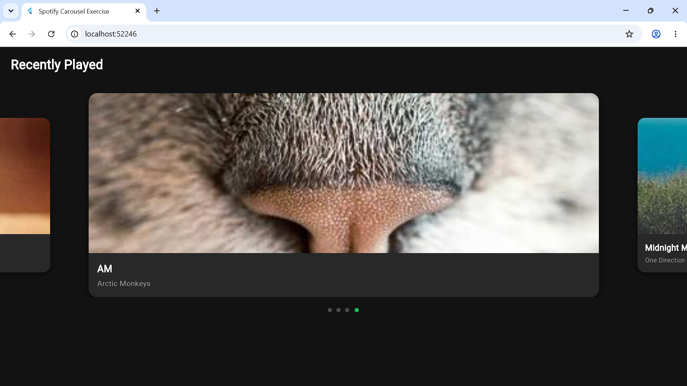
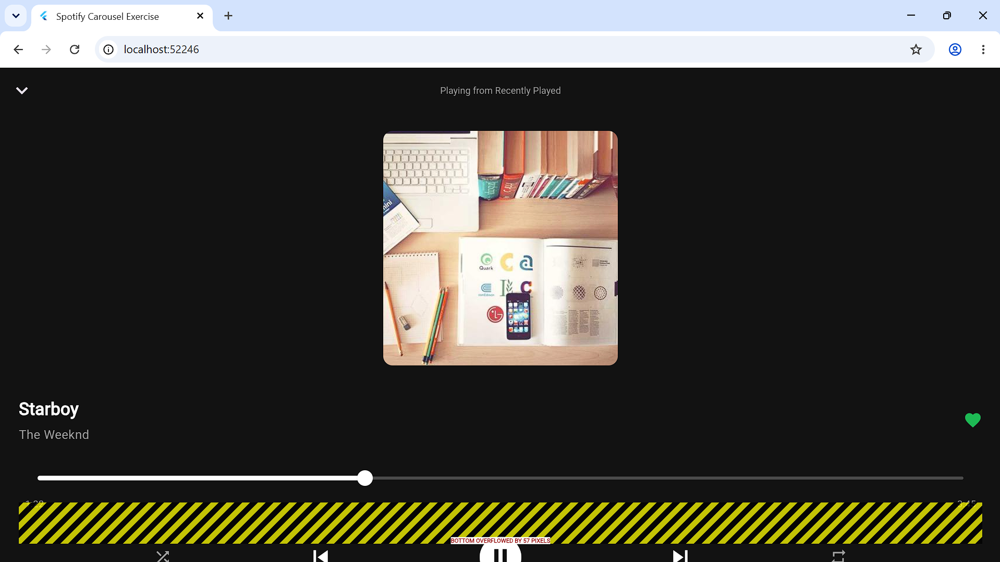

# Spotify Flutter Carousel & Now Playing Exercise

Aplikasi seluler berbasis Flutter yang dikembangkan untuk memenuhi tugas pemrograman perangkat bergerak. Proyek ini mengimplementasikan antarmuka (*user interface*) yang terinspirasi dari aplikasi **Spotify**, dengan fokus utama pada pemanfaatan carousel lagu dan navigasi ke halaman pemutar musik (*Now Playing*).

## 🚀 Fitur Utama
- **Spotify-Inspired Dark Theme**: Desain antarmuka bertema gelap khas Spotify (`#121212` dan aksen hijau `#1DB954`).
- **Carousel Slider**: Menampilkan daftar album dan lagu terbaru menggunakan *package* `carousel_slider` dengan animasi yang interaktif dan *auto-play*.
- **Interactive Card & Navigation**: Kartu album dapat diklik untuk berpindah secara mulus ke halaman pemutar musik (*Player Screen*).
- **Now Playing Screen**: Halaman pemutar musik lengkap yang memuat informasi detail lagu, tombol *Play/Pause*, *progress bar* durasi lagu, hingga tombol kontrol pemutaran lainnya.
- **Indikator Halaman**: Titik indikator aktif dinamis di bawah carousel untuk memantau posisi lagu yang sedang dipilih.

## 🛠️ Teknologi yang Digunakan
- **Flutter & Dart**
- **Package `carousel_slider`** (untuk tata letak carousel interaktif)

---

## 📸 Tangkapan Layar (Screenshots)

Berikut adalah tampilan antarmuka dari aplikasi Spotify Flutter ini:

### 1. Tampilan Beranda (Home Screen & Carousel)

### 2. Tampilan Pemutar Musik (Now Playing Screen)
